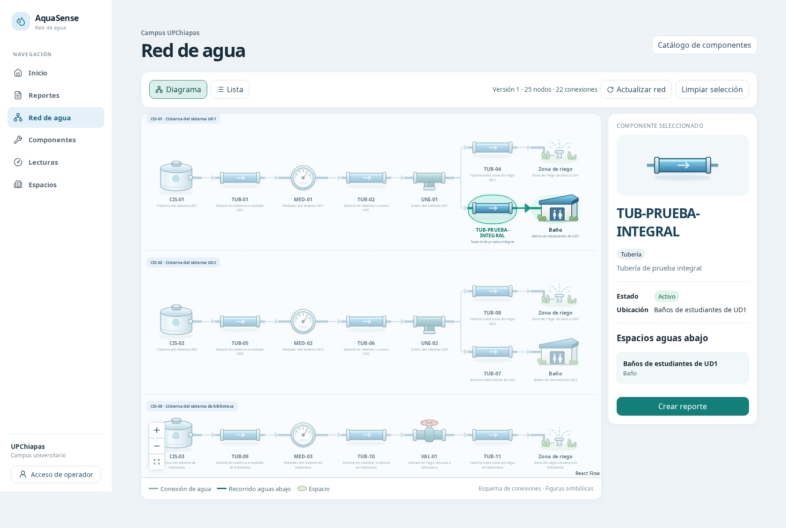

# AquaSense

Aplicación académica para registrar y consultar una red de agua, capturar
lecturas manuales y seguir reportes de mantenimiento hasta su cierre.
El campus de UPChiapas proporciona el escenario inicial de demostración.



## Ejecutar con Docker

Requisitos: Git y Docker con Compose v2. En Windows, Docker Desktop debe estar
abierto en modo de contenedores Linux. La primera construcción necesita Internet.

```powershell
git clone https://github.com/jacalvoag/aquasense-database.git
cd aquasense-database
docker compose up --build -d --wait --wait-timeout 300
```

Abre **http://localhost:5173**. Acceso local de demostración:
**operador** / **aquasense-operador-local**.

Se inician PostgreSQL, MongoDB, Neo4j, la inicialización verificada, la API,
el sincronizador y el frontend Nginx. No necesitas instalar Node ni los
motores en el host. Si ya utilizas los puertos 3000/5173, detén esas aplicaciones
o configura otros puertos siguiendo [la guía Docker](docs/docker.md).

```powershell
docker compose ps
docker compose logs --tail=80 api sincronizador
docker compose down
```

`down` conserva los registros en los volúmenes. `down -v` elimina los datos de
este entorno Docker. Las bases que tienes instaladas directamente en tu equipo
son independientes y no se importan ni modifican.

## Qué puedes hacer

- Registrar espacios y cisternas, tuberías, uniones, válvulas y medidores.
- Crear, modificar y eliminar conexiones respetando las reglas de la red.
- Consultar el diagrama y el alcance aguas abajo, con actualización automática
  después de confirmar la sincronización.
- Capturar lecturas acumuladas y consultar el consumo del intervalo.
- Crear reportes, agregar inspecciones, reemplazar tuberías, verificar y cerrar.
- Consultar expedientes y distinguir el estado operativo de la confirmación
  documental y del grafo.

Los componentes se registran sin conexiones. Puedes conectarlos para formar
ramales; las tuberías también pueden instalarse mediante un reemplazo.
Los registros se conservan al reiniciar. Sigue el [ensayo de un ramal nuevo](docs/red-dinamica.md).

## Configuración

| Ejecución | Archivo o variable | Uso |
| --- | --- | --- |
| Docker | `.env` opcional en la raíz | Puertos publicados, credenciales y nombres de bases; valores documentados en la guía. |
| Docker | `/api` | Ruta del navegador en su mismo origen; Nginx la dirige a la API interna. |
| Nativa | `api/.env` y `sincronizador/.env` | Conexiones a los mismos motores y credencial del operador. |
| Nativa | `FRONTEND_PORT` en `api/.env` | Puerto que abre el lanzador; predeterminado 5173. Autoriza su origen en CORS_ORIGINS. |
| Frontend nativo | `frontend/.env.local` | VITE_API_BASE_URL para una API distinta de la dirección local predeterminada. |
| Frontend | VITE_ESCENARIO y VITE_INSTITUCION | Rótulos visuales; variables de build en Docker o `.env.local` en Vite. |

Las credenciales no se incluyen en el código del navegador. La API valida las
escrituras y la interfaz conserva la credencial del operador solo en memoria.
Los valores predeterminados de Compose son para demostración local; los puertos
se publican únicamente en loopback. No es una configuración de producción pública.

## Ejecutar sin Docker

Sigue la [guía nativa](docs/ejecucion-local.md). Con bases preparadas, archivos
`.env` configurados y desde la raíz, en Windows:

```powershell
.\iniciar.ps1 -Instalar
```

Para actualizar una instalación anterior a la red dinámica, consulta las
[migraciones 35 y 36](docs/red-dinamica.md). No vuelvas a ejecutar la carga base
sobre bases que ya contienen trabajo.

## Arquitectura

| Motor | Responsabilidad |
| --- | --- |
| PostgreSQL | Datos operativos, lecturas, conexiones, reportes, reemplazos y eventos; restricciones y transacciones. |
| MongoDB | Expediente por reporte con el detalle de atenciones y su secuencia aplicada. |
| Neo4j | Proyección de conexiones, recorridos dirigidos e historial de reemplazos. |

React consulta la API NestJS. Las escrituras y los eventos se registran en
PostgreSQL. El sincronizador aplica los cambios en MongoDB/Neo4j y confirma los
eventos. La API verifica versiones y secuencias antes de entregar proyecciones
como actuales. El [contrato](docs/api/contrato.md) explica los estados y errores.

## Pruebas y evidencias

- [Pruebas reproducibles del sistema y navegador](pruebas/README.md).
- [Resultados históricos, medición y límites](docs/validacion.md).
- [Evidencias fechadas](pruebas/evidencias/2026-11-27/README.md).
- [Comparación de estructura PostgreSQL](herramientas/README.md).

GitHub Actions comprueba código, aplicación Docker, persistencia tras recrear
contenedores y arranque de Vite en Windows. La prueba Docker usa puertos,
credenciales y nombres de bases distintos de los predeterminados para detectar
dependencias de esos valores. Los datos del escenario y las comprobaciones
esperadas de pruebas están separados de la lógica operativa.

## PostgreSQL: estructura y carga base

La [preparación de bases nuevas](docs/preparacion-bases.md) conserva los pasos
SQL, MongoDB y Neo4j y el [ejemplo manual](docs/ejemplo-reporte-reemplazo.md).
En Docker esa preparación inicial se realiza automáticamente.

## Alcance

Las lecturas e infraestructura del ejemplo son datos académicos. Los registros
y cambios de la aplicación se guardan realmente en las bases. El diagrama
representa conectividad, sin simular presión o caudal. El prototipo no incluye
sensores, detección automática de fugas ni ahorro de agua medido.

El modo documentado utiliza un operador y un sincronizador. El esquema SQL,
los tipos admitidos y los identificadores de control son contratos del modelo;
los identificadores de registros operativos se generan y consultan dinámicamente.

## Equipo

José Antonio Calvo Aguilar y Uzzi Yazziel Gonzaga Gómez. Ingeniería en
Tecnologías de la Información e Innovación Digital, Universidad Politécnica de
Chiapas. Docente: Horacio Irán Solís Cisneros.

[Demostración](docs/demostracion.md) · [Diagnóstico](docs/solucion-problemas.md) ·
[Informe técnico](docs/informe-tecnico.md) · [Historial](CHANGELOG.md)
