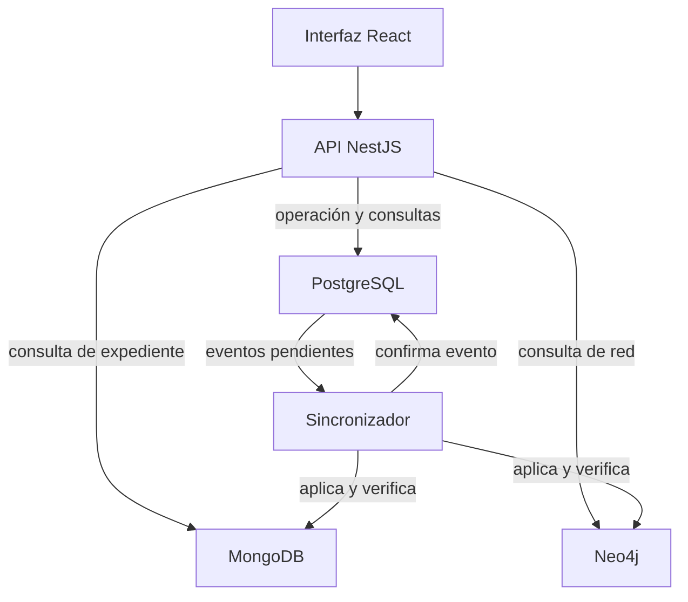

# AquaSense

**Seguimiento del mantenimiento y consulta de una red de agua.** Prototipo
académico con lecturas manuales, expedientes de reportes y recorridos aguas abajo.
El campus de la Universidad Politécnica de Chiapas es el escenario de demostración.


Captura de una ejecución real del 27 de noviembre de 2026. Las figuras son
simbólicas; los componentes, conexiones y recorridos proceden de la API.

[Construir ramales](docs/red-dinamica.md) ·
[Arranque local](docs/ejecucion-local.md) ·
[Guion de demostración](docs/demostracion.md) ·
[Solución de problemas](docs/solucion-problemas.md) ·
[Informe técnico](docs/informe-tecnico.md) ·
[Contrato de la API](docs/api/contrato.md) ·
[Resultados y límites](docs/validacion.md)

## Arranque completo con Docker

```powershell
docker compose up --build -d --wait --wait-timeout 300
```

Abre http://localhost:5173. Operador de demostración: `operador` /
`aquasense-operador-local`. Docker prepara las tres bases y las aplicaciones
con volúmenes persistentes. Consulta [la guía completa](docs/docker.md) para
instalación, puertos, reinicio y límites de esta configuración local.

## Qué permite hacer

- Registrar espacios y componentes de los cinco tipos admitidos.
- Crear, modificar y eliminar conexiones, con confirmación y actualización automática del diagrama.
- Consultar espacios, componentes, lecturas y reportes.
- Registrar lecturas acumuladas y obtener el consumo entre lecturas.
- Crear un reporte, documentar inspección, reparación y verificación, y cerrarlo.
- Preparar una tubería sin conexiones e instalarla mediante el reemplazo de
  otra existente, conservando sus conexiones, o conectarla para crear un ramal.
- Explorar una red ilustrada, consultar los espacios aguas abajo y revisar
  la confirmación documental y del grafo por separado.
- Ver en la portada los reportes pendientes y en atención, los componentes
  activos, la lectura más reciente y la disponibilidad de los tres motores.

La credencial de operador habilita escrituras. Las consultas son públicas.
La API verifica cada operación y el sincronizador confirma los cambios de
MongoDB y Neo4j de forma recuperable.

## Actualizar desde la versión 1.0.0

Conserva tus archivos de configuración y tus bases. Detén temporalmente API, sincronizador
y frontend y aplica las migraciones aditivas 35 y 36:

```powershell
node --env-file=sincronizador/.env herramientas/actualizar-red.mjs --aplicar
```

La [guía de red dinámica](docs/red-dinamica.md) reúne los pasos de actualización
y un ensayo para registrar y conectar un ramal nuevo sin cargar datos manualmente.

## Ejecutar en Windows

Necesitas las tres bases preparadas y encendidas, Node.js y npm. Usa Node 26
para reproducir la configuración recomendada. La [guía local](docs/ejecucion-local.md)
explica los archivos `.env`; no se suben a Git.

Desde la **raíz del repositorio**, donde están `api/`, `sincronizador/`
y `frontend/`:

```powershell
.\iniciar.ps1 -Instalar
```

En los siguientes arranques:

```powershell
.\iniciar.ps1
```

El lanzador comprueba las bases y abre las tres aplicaciones en terminales
separadas. No instala motores ni carga datos. Para detener las aplicaciones,
usa Ctrl+C en cada terminal. Si ya están abiertas, utiliza sus sesiones
existentes o ciérralas antes de ejecutar el lanzador.

Solo configuración y dependencias, sin conexiones ni arranque:
`.\iniciar.ps1 -SoloComprobar`. También puedes arrancar cada aplicación
[por separado](docs/ejecucion-local.md#arranque-manual).

## Por qué tres bases de datos

| Motor | Responsabilidad | Adecuación al trabajo |
| --- | --- | --- |
| PostgreSQL | Datos operativos, lecturas, reportes, conexiones, reemplazos y eventos. | Restricciones y transacciones mantienen coherente cada operación. |
| MongoDB | Un expediente por reporte, con el detalle de sus atenciones. | Agrupa el historial documental y admite campos distintos por tipo de atención. |
| Neo4j | Proyección de conexiones y reemplazos para recorridos dirigidos. | Expresa ramales y consultas aguas abajo mediante relaciones entre nodos. |

Se eligieron responsabilidades complementarias. Esto no demuestra que los
otros motores sean incapaces de resolverlas; la integración es parte del
objetivo académico.



La respuesta de una escritura confirma PostgreSQL. La interfaz espera los
eventos correspondientes antes de presentar el expediente o la red como
sincronizados. Consulta el [contrato](docs/api/contrato.md) para los estados
y errores.

## Comprobar y reproducir

Las [pruebas aisladas](pruebas/README.md) ejecutan el flujo completo y su
recuperación con los tres motores. La [validación documentada](docs/validacion.md)
separa pruebas unitarias, HTTP con drivers simulados, ejecución real y
mediciones históricas. GitHub Actions conserva los resultados de cada nueva
ejecución como artefactos; no sustituye las evidencias históricas.

La comparación local de `aquasense` y `aquasense_reconstruccion` reportó
**190 objetos coincidentes**, sin faltantes, adicionales ni diferencias.
El [resumen](pruebas/evidencias/2026-11-27/comparacion-original-resumen.json)
se conserva separado de la comparación entre reconstrucciones aisladas.

## PostgreSQL: estructura y carga base

La preparación de bases nuevas está en [preparacion-bases.md](docs/preparacion-bases.md).
Incluye las cantidades de la carga inicial, los pasos de MongoDB y Neo4j y el
[ejemplo manual de reporte y reemplazo](docs/ejemplo-reporte-reemplazo.md).
No vuelvas a cargar los scripts sobre las bases usadas para la presentación.

## Alcance y límites

Los espacios sirven de referencia académica. Las conexiones, tuberías,
lecturas y reportes son datos supuestos o de prueba. El diagrama representa
conectividad; no es un plano técnico ni una simulación de presión o caudal.
El prototipo no detecta fugas automáticamente ni demuestra ahorro de agua.

La aplicación local utiliza un operador y un sincronizador. Se pueden registrar
espacios y componentes y administrar las conexiones desde la aplicación. Los componentes nuevos pueden conectarse para formar ramales;
las tuberías también pueden instalarse mediante un reemplazo. Los sensores y
una infraestructura pública de producción quedan fuera de esta entrega.

## Equipo

- José Antonio Calvo Aguilar.
- Uzzi Yazziel Gonzaga Gómez.

Ingeniería en Tecnologías de la Información e Innovación Digital,
Universidad Politécnica de Chiapas. Docente: Horacio Irán Solís Cisneros.

La [versión académica 1.1.1](docs/version-1.1.1.md) describe la entrega;
el [historial de cambios](CHANGELOG.md) conserva sus novedades.
