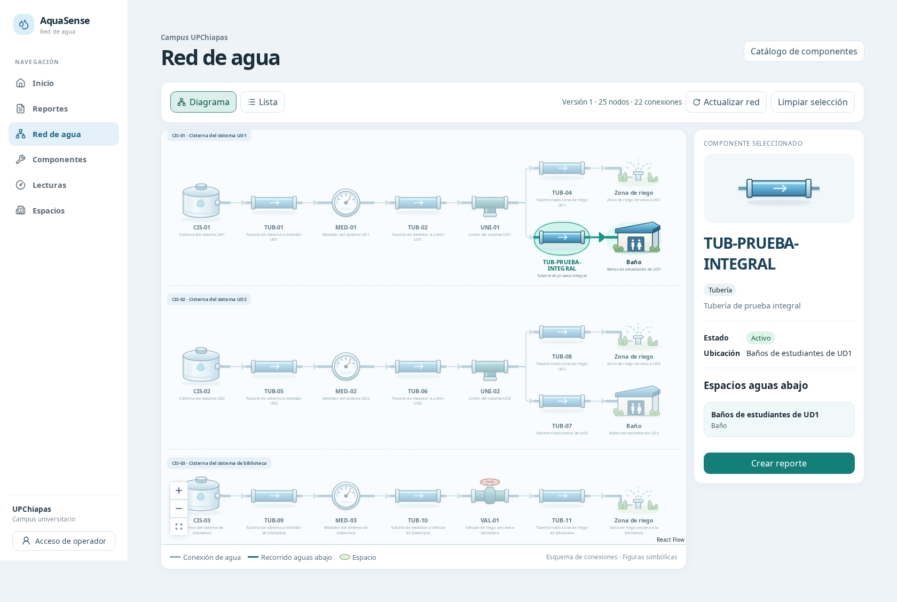
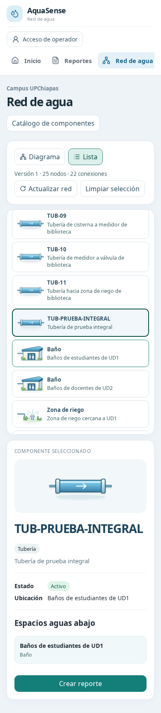

# Evidencias del 27 de noviembre de 2026

Ejecución nativa aislada en Linux, con Node.js 24.22.3, PostgreSQL 16.15,
MongoDB 7.0.48 y Neo4j Community 5.26.34. Se usó el código de las pruebas
incluidas en este repositorio. No se sustituyeron drivers ni respuestas HTTP.

MongoDB 8.0.38 no pudo iniciarse en este entorno por el acceso no disponible a
la información de CPU que necesita su asignador de memoria. Por ello se ejecutó
esta prueba de compatibilidad con MongoDB 7.0.48. La validación histórica del
25 de noviembre usa MongoDB 8.0.38 y se conserva separada en
[docs/validacion.md](../../../docs/validacion.md). La configuración Compose
con MongoDB 8 se proporciona para reproducir la prueba; Docker no se ejecutó
en esta sesión.

| Comprobación | Resultado |
| --- | --- |
| API unitaria | 58 pruebas aprobadas |
| Contrato HTTP de la API, con drivers simulados | 18 pruebas aprobadas |
| Sincronizador unitario | 4 pruebas aprobadas |
| Selección, fallos y bloqueo contra PostgreSQL real | 5 pruebas aprobadas; `test-integracion.txt` |
| Sistema completo con tres motores | 1 prueba aprobada, con siete grupos de comprobaciones; `sistema.json` y `test-sistema.txt` |
| Navegador con API y motores reales | 1 prueba aprobada en escritorio y móvil; `test-visual.txt` y capturas |
| Comparador de estructura | 4 pruebas unitarias aprobadas y comprobación contra dos bases reales reconstruidas |
| TypeScript, build y lint | API, sincronizador y frontend aprobados según los comandos aplicables |

El estado final contiene un reporte cerrado, un expediente con tres atenciones,
una tubería reemplazada, red versión 1 y consumo de intervalo de 2.500 m³. Los
identificadores de esa ejecución se guardan en `identificadores.json`.

`estructura-reconstruida.json` contiene el inventario de la reconstrucción.
`comparacion-reconstrucciones.json` compara dos reconstrucciones independientes,
con 12 tablas, 69 restricciones, 27 índices, 21 funciones, 6 triggers y 1 vista.
Sus campos `original` y `reconstruccion` son los nombres genéricos del comparador:
**ninguno representa aquí la base histórica del equipo**. Esta evidencia prueba
la reproducibilidad de los scripts, no la coincidencia con aquella base.

`deteccion-indice.json` muestra que el comparador detectó la retirada de
`evento_pendiente_idx`. La retirada se hizo en una transacción que terminó en
`ROLLBACK`. También se comprobó el exportador Node con dos bases reales nuevas.

`manifest.json` permite verificar tamaños y hashes SHA-256 de los archivos.
`comparacion-original-resumen.json` conserva por separado la salida compartida
por el responsable al comparar sus bases locales `aquasense` y
`aquasense_reconstruccion`: 190 objetos coincidentes, sin diferencias. Incluye
123 restricciones en cada base. No contiene sus snapshots ni hashes originales,
y no debe confundirse con la comparación aislada de dos reconstrucciones.

Las capturas corresponden al estado posterior al reemplazo:

